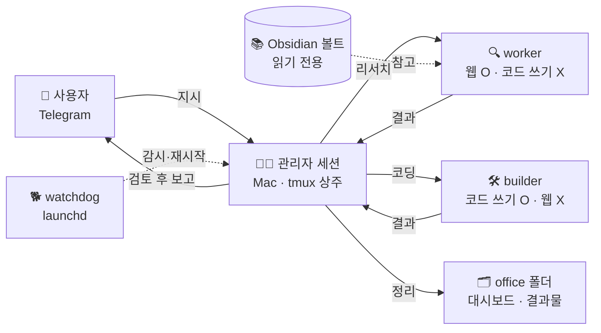

<div align="center">


# Nidus

**Telegram으로 일을 맡기면, 맥에 상주하는 Claude Code가 팀을 꾸려 처리하고 검토까지 끝내 보고하는 개인 비서 사무실**


</div>

---

## 어떤 앱인가요?

Nidus는 **항상 켜 둔 Mac에서 돌아가는 Claude Code 플러그인**입니다.

- 📱 휴대폰 Telegram으로 *"NVDA 분석해 줘"*, *"이 레포에 기능 추가해 줘"*처럼 지시합니다.
- 🧑‍💼 Mac의 **관리자 세션**이 지시를 받아 task로 만들고, 워커에게 순서대로 일을 나눠 줍니다.
- 🔍 **worker**가 웹과 자료를 조사하고, 🛠️ **builder**가 코드를 씁니다.
- ✅ 관리자가 체크리스트로 결과를 **직접 다시 확인**한 뒤 Telegram으로 보고합니다.
- 📚 Obsidian 볼트는 **읽기 전용 자료실**로 참고하고, 결과물은 볼트 안의 office 폴더에 정리해 둡니다.

API 키 없이 **Claude 구독 안의 공식 기능**(Claude Code, Channels, 플러그인)만 씁니다.



## ✨ 주요 기능

| | 기능 | 설명 |
|---|---|---|
| 💬 | **Telegram 지시·보고** | 어디서든 메시지로 일을 맡기고, 끝나면 알림을 받습니다. 작업 중에 보낸 메시지도 inbox에 쌓여 빠짐없이 처리됩니다. |
| 👥 | **역할을 나눈 워커 팀** | 리서치(worker)와 코딩(builder)을 분리했습니다. 웹에서 읽은 내용이 곧바로 코드 수정으로 이어지지 않습니다. |
| ✅ | **관리자 직접 검토** | 핵심 숫자 재조회, 계산 재현, 기준일, 출처, 결론 일치를 체크리스트로 확인합니다. |
| 🔁 | **반복 작업** | `jobs.md`에 적어 둔 일을 `/loop`로 주기적으로 돌립니다. |
| 🗂️ | **검토하기 쉬운 office** | `00.dashboard.md` 하나만 보면 검토할 것, 막힌 것, 진행 중인 것이 보입니다. |
| 🐕 | **watchdog** | 세션이 꺼지거나 멈추거나 Telegram이 끊기면 알아서 재시작하고 알려 줍니다. 매일 아침에는 깨끗하게 새로 시작합니다. |
| 🚦 | **메뉴바 상태** | 둥지 아이콘의 알 색깔로 지금 상태를 바로 확인합니다(SwiftBar). |
| 🔒 | **권한 설정** | 어디에 쓰고, 어디를 못 쓰고, 어디를 못 읽게 할지 설정 파일 하나로 정합니다. |

### 🚦 메뉴바 아이콘

둥지 속 알의 색이 세션 상태를 알려 줍니다.


| <br>대기 | <br>작업 중 | <br>승인 대기 | <br>Telegram 끊김 | <br>꺼짐 |
|:---:|:---:|:---:|:---:|:---:|
| 지시를 기다리는 중 | 일하는 중 | 확인이 필요함 | 곧 자동 복구 | watchdog이 다시 띄움 |

## 🔒 안전장치

- **볼트는 읽기 전용**입니다. office 폴더만 예외입니다.
- **역할별로 권한을 나눕니다.** 웹은 worker만, 코드 쓰기는 builder만 쓸 수 있습니다. 이 플러그인 자체와 설정 파일은 누구도 고칠 수 없습니다.
- **main·master push와 force push를 막습니다.** builder는 `nidus/<task>` 브랜치에서만 작업하고, 병합은 사용자가 결정합니다.
- **자격 증명 경로를 차단합니다.** `.ssh`, `.env` 같은 경로는 읽기와 쓰기 모두 막습니다.
- **볼트 내용이 밖으로 나가지 않게 합니다.** 웹 검색에는 공개된 식별자만 쓰고, 사용한 검색어와 URL은 모두 기록해 검토합니다.
- 주문, 매매, 결제, 외부 계정 접근은 하지 않습니다.

## 🚀 빠른 시작

**필요한 것**
- macOS. 로그인한 상태로 켜 둘 Mac이 있어야 합니다.
- Claude Code와 Claude 구독. Channels를 지원하는 버전이어야 합니다.
- Telegram 봇 1개 (BotFather `/newbot`으로 만듭니다)
- 도구: `bun`, `tmux`, `node`. `python3`는 선택이고, 메뉴바를 쓰려면 SwiftBar도 설치합니다.

```sh
# 1. 받기
git clone https://github.com/zzaehong/nidus-plugin.git && cd nidus-plugin
brew install bun tmux

# 2. (선택) 권한 설정: 없으면 ~/Developer만 builder가 쓸 수 있습니다
mkdir -p ~/.config/nidus && $EDITOR ~/.config/nidus/config

# 3. 사무실 열기: 볼트 경로와 office 폴더를 지정합니다
scripts/office.sh ~/MyVault ~/MyVault/nidus_office

# 4. (선택) 자동 감시와 재시작
scripts/watchdog.sh install ~/MyVault ~/MyVault/nidus_office
```

세션에서 Telegram을 연결하고 페어링하는 순서는 **[plugin/README.md › 준비](plugin/README.md#준비-1회)**를 따르면 됩니다.

<details>
<summary><b>⚙️ 권한 설정 예시</b> (<code>~/.config/nidus/config</code>)</summary>

```ini
# builder만 쓸 수 있는 폴더 (여러 줄 가능)
writable = ~/Developer
writable = ~/Projects

# 누구도 못 쓰는 경로
readonly = ~/Developer/my-app/data

# 누구도 못 읽는 경로
noread = ~/Documents/private

# 일일 재시작(06~08시) 시간대
tz = Asia/Seoul
```
자세한 규칙과 한계는 [plugin/README.md › 권한 설정](plugin/README.md#권한-설정)에 있습니다.
</details>

## 🗂️ office 폴더

```
nidus_office/
├── 00.dashboard.md        ← 여기만 보면 됩니다 (검토 대기 · 막힘 · 진행 중 · 최근 완료)
├── jobs.md                ← 반복 작업 목록
├── outputs/<분야>/<대상>.md ← 계속 갱신되는 결과물 (review: 대기 → 확인)
├── tasks/YYYY-MM/<id>/    ← 작업 기록 (report.md + workers/)
└── system/                ← inbox · handoff · watchdog 기록
```

## 📁 레포 구조

| 경로 | 내용 |
|---|---|
| [`plugin/`](plugin/) | 플러그인 본체: 스킬(office·library·team-stock), 에이전트(worker·builder), 훅(guard·inbox) |
| [`scripts/`](scripts/) | `office.sh` 실행, `watchdog.sh` 감시, `nidus-status.10s.sh` 메뉴바 |
| [`tests/`](tests/) | `npm test` |
| [`docs/verification.md`](docs/verification.md) | 공식 문서 검증과 실측 기록 |
| [`CHANGELOG.md`](CHANGELOG.md) | 변경 내역 |

> 💡 **새 분야 팀 추가하기**: 주식 4관점 팀(`team-stock`)은 예시일 뿐입니다. `plugin/skills/team-<이름>/`에 관점과 검토 기준을 적으면 어떤 분야든 팀을 만들 수 있습니다.

## ⚠️ 알아 둘 점

- **Channels는 research preview 기능**이라 사용법이 바뀔 수 있습니다.
- **구독 사용 한도를 씁니다.** 워커는 Sonnet으로 순서대로 돌려 한도를 아낍니다. 참고로 분석 1건이 5시간 한도의 약 4%를 썼습니다.
- **Mac은 로그인한 상태로 켜 두어야 합니다.** launchd 사용자 에이전트로 동작하기 때문입니다.
- **마켓플레이스 설치는 지원하지 않습니다.** `scripts/`가 함께 설치되지 않아서, 레포를 clone해서 씁니다.

## 📄 라이선스

[MIT](LICENSE)
